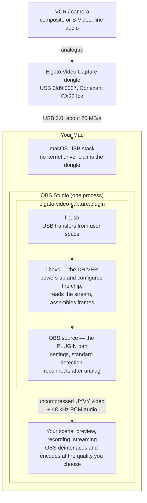

# Elgato Video Capture for macOS

A user-space macOS driver and OBS Studio plugin for the Elgato Video Capture USB dongle (the analogue capture stick sold for digitising VHS), second hardware generation, USB ID `0fd9:0037`.

It gives OBS the device's **uncompressed** output directly: 720×480 or 720×576, 4:2:2, about 20 MB/s, plus 48 kHz stereo PCM. Nothing is encoded on the way, so quality and bit rate are whatever you set in OBS.

## Status

**Alpha.** Working on macOS 27 (Apple silicon) with OBS 33.0.2: a PAL VHS tape on the composite input shows in OBS with sound. NTSC and S-Video run but have only been tested without a signal. See [what is verified and what is not](docs/05-macos-driver.md#55-what-has-been-verified-and-what-has-not).

## Install from the package

1. Download `elgato-video-capture-<version>-macos-arm64.pkg` from the [Releases page](../../releases) and open it.
   The package is not signed with an Apple Developer ID, so macOS blocks it the first time. Open **System Settings ▸ Privacy & Security**, scroll to the message about the package, and click **Open Anyway**.
2. Follow the installer. It installs for your user only, into `~/Library/Application Support/obs-studio/plugins`, and asks for no password.
3. Quit Elgato's own Video Capture application if it is open; only one program can use the dongle.
4. Restart OBS, then Sources ▸ **+** ▸ **Elgato Video Capture (analogue)**.

Requirements: a Mac with Apple silicon, macOS 13 or later, OBS Studio 33.

In OBS, turn on deinterlacing from the source's right-click menu (Yadif 2x) and stretch the source to 4:3; the video standard (PAL or NTSC) is detected automatically. Details are in [chapter 5](docs/05-macos-driver.md).

To uninstall, delete `~/Library/Application Support/obs-studio/plugins/elgato-video-capture.plugin`.

There is no kernel extension and nothing else to approve: the device's interfaces are vendor-specific, so macOS leaves them to user space.

## Build it yourself

You need the Xcode command line tools (`xcode-select --install`) and OBS Studio in `/Applications`.

```sh
git clone https://github.com/Evilu/elgato-video-capture-mac.git
cd elgato-video-capture-mac
./build.sh install        # build the plugin and install it for your user; then restart OBS
./build.sh package 0.0.1-alpha  # or: build the installer, out/elgato-video-capture-0.0.1-alpha-macos-arm64.pkg
```

The first build downloads three things into `out/deps`: the `libobs` headers for the OBS version you have installed, the SIMDe headers they need, and the libusb source, which is compiled into the plugin. The plugin is built for the OBS version it finds; rebuild after a major OBS update.

The command-line tools (`out/evc-capture` and the USB diagnostics) are built as well if Homebrew's libusb is present (`brew install libusb`).

## How it works: a driver inside a plugin

It is both. The **driver** is a small library, `libevc`, that knows how to talk to the dongle. The **plugin** is what OBS loads; it contains the driver and hands OBS the frames. There is no separate driver to install in macOS.



| Layer | What it is | Where |
|---|---|---|
| Hardware | The dongle digitises the analogue signal and sends raw video and audio over USB | |
| macOS | Passes USB traffic through. The dongle's interfaces are vendor-specific, so macOS attaches no driver of its own and an application may use them directly | |
| libusb | Open-source library for USB access from an ordinary program | compiled into the plugin |
| **Driver** (`libevc`) | The device-specific part: the start-up sequence, input and standard selection, and turning the USB byte stream into video frames and audio samples | `src/libevc` |
| **Plugin** | Wraps the driver as an OBS source with a settings panel | `src/obs-plugin` |
| OBS | Everything after that: deinterlacing, scaling, encoding, recording | |

The same driver library also runs outside OBS, in the command-line tool `evc-capture` (`src/tools`). Because the driver lives inside the plugin, the dongle appears only in OBS, not as a system-wide camera in other applications; that would need a separate macOS camera extension ([chapter 5](docs/05-macos-driver.md#56-known-limitations-and-next-steps)).

## How it was made

Elgato's Windows driver was unpacked and decompiled with Ghidra to learn how the device is initialised and what it sends. That identified the chip as a Conexant CX231xx, for which Linux has an open-source driver, and the macOS driver is a port of the Linux register sequences corrected against the vendor driver's settings for this board and checked on the hardware. It is a reimplementation: a Windows kernel driver cannot be recompiled for macOS, for reasons set out in [chapter 1](docs/01-drivers-and-porting.md).

```
./build.sh analyse     # optional: unpack your copy of the installer and decompile it
```

needs `brew install sevenzip ghidra openjdk@21` and your own `Video_Capture_Driver_Installer.exe` in this directory.

## Layout

| Path | Contents |
|---|---|
| `docs/` | [Documentation](docs/README.md): background, hardware, the Windows driver, the device protocol, the macOS driver |
| `src/libevc/` | The driver: device bring-up, streaming, video parser |
| `src/obs-plugin/` | OBS source plugin |
| `src/tools/` | `evc-capture`, a command-line capture and diagnostic tool |
| `tools/` | Unpack, decompile and plugin build scripts; USB diagnostics |
| `build.sh`, `Makefile` | Build entry points |
| `analysis/` (ignored) | The unpacked installer, Ghidra exports, reference sources |
| `out/` (ignored) | Build products |

## No Elgato files

This repository contains no installer, driver binary, firmware or decompiler output, and `.gitignore` keeps them out. The driver needs none of them to build or run. To study the Windows driver you supply your own copy of the installer, and everything derived from it stays in `analysis/` on your machine.

## Thanks

This project stands on other people's work:

- The authors and maintainers of the Linux kernel's **cx231xx** and **cx25840** drivers, whose open code made it possible to understand this chip, and whoever contributed the Elgato Video Capture V2 board entry.
- **Ghidra** and its developers at the NSA, for the decompiler used to study the Windows driver.
- **libusb**, for user-space USB on macOS, including isochronous transfers.
- **OBS Studio**, for a plugin interface that accepts uncompressed frames directly.
- **SIMDe** and **7-Zip**, used in the build and the unpacking step.
- **Conexant**, for the chip and the reference design.
- **Elgato**, for the hardware.

## Licence and rights

Everything in this repository is GPL-2.0-or-later (see `LICENSE`). The driver in `src/` has to be, because it ports code from the Linux kernel's `cx231xx` and `cx25840` drivers; OBS Studio is GPL-2.0-or-later as well. The released plugin statically links libusb (LGPL-2.1-or-later).

Elgato, Elgato Video Capture and the Windows driver belong to their owners (Elgato, a Corsair brand). This is an independent interoperability project with no affiliation with or endorsement by them.
